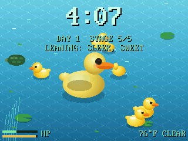
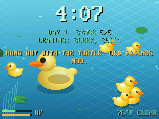
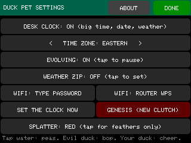
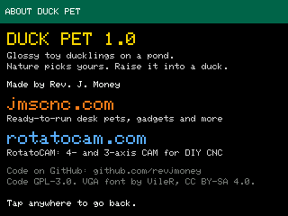
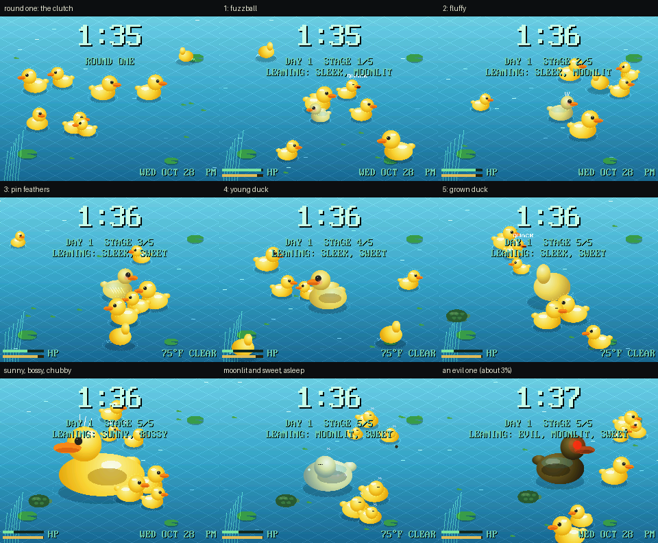
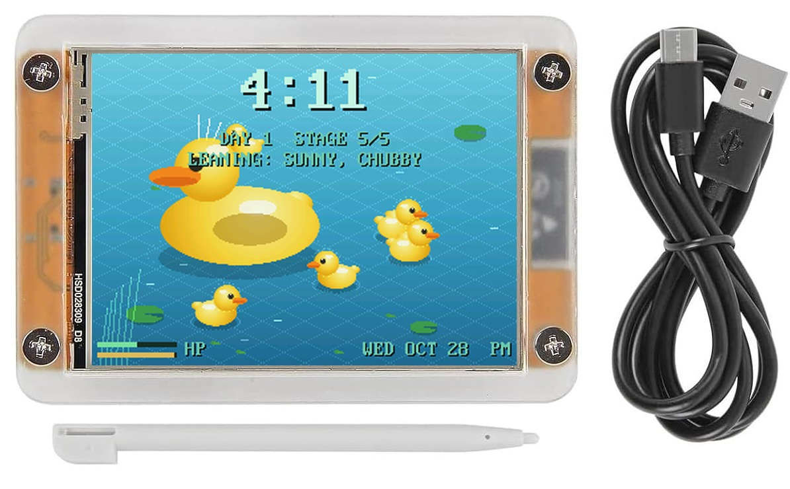

# Duck Pet

**Lil baby duckies on a $15 touchscreen.** A clutch of glossy toy ducklings paddles around a pond that fills the whole screen. Nature picks which one is yours. Over about a week it grows into a duck, and the way you raise it decides what kind of duck you get. It doubles as a desk clock you can leave on all day.

Duck Pet is open-source firmware for the **ESP32-2432S028R**, the 2.8" "Cheap Yellow Display" (CYD). Everything is drawn live at the panel's full 320x240, at about 30 frames a second, with both of the ESP32's cores sharing the work. There are no sprites and no stored pictures: every duckling, ripple, lily pad and goldfish is drawn fresh each frame.



*Captured straight off the board: grown ducks, ducklings, the turtle, and a couple of silly achievements.*

## What it does

- **Round one: nature picks.** A fresh pond holds a clutch of 8 ducklings, each born with its own leanings. They paddle, dabble, eat and squabble. The first one to prove itself gets a crown and **THIS ONE IS YOURS**. You can toss food to nudge nature along, but you can't pick.
- **A week of growing, in five stages:** fuzzball, fluffy, pin feathers, young duck, and a big grown duck.
- **How you raise it shapes it:**
  - **Room light:** the light sensor on the front counts the room's daytime light. A bright room makes a sunny yellow duck; a dim one makes a pale moonlit duck that sparkles at night.
  - **Squabbles:** winning them makes a bossy duck with a crest; a peaceful life makes a sweet one with big eyes and a blush.
  - **Feeding:** lots of food from you makes it chubby; foraging alone makes it sleek.
  - Each stage locks in the care so far, so its history shows.
- **Duck stuff:** paddling, dabbling (tail up!), preening, quacking, splashing, and napping with its head tucked in at night.
- **Visitors turn up now and then:** bugs skitter, frogs hop in off the lily pads, and goldfish glint under the surface. Ducks chase them down. A turtle paddles across once in a while.
- **Evil ducklings.** Once in a while a duckling hatches evil: dark feathers, a scowl and one glowing red eye. It hunts the others and eats them, unless a brave duckling gets the 12% upset and bonks it into a puff of feathers. About 3% of pets turn out evil and stay that way, with their own villain achievements. The **SPLATTER** setting picks red or feathers only.
- **It never dies.** If an evil one gets your duck, it flees hurt and recovers. A neglected duck forages on its own.
- **Silly achievements.** Every 3 to 45 minutes a line pops up from a pool of 150, written for each stage, like *HUNG OUT WITH THE TURTLE. OLD FRIENDS NOW.* A few fire on real events, like its first frog.
- **The RGB LED on the back blinks along** with its meals and big moments.
- **Desk clock.** A big time with the date and local weather, set over WiFi at boot. The radio switches off again so the pond gets all the memory, and the clock resyncs every night at 4 AM.
- **Pause anytime.** EVOLVING: PAUSED holds it at its current stage for as long as you like. GENESIS starts a fresh clutch (it asks first).

| An achievement | The settings | About |
|---|---|---|
|  |  |  |



## Get one

[](https://jmscnc.com/product/duck-pet-toy-ducklings-on-a-2-8-touchscreen-pond-ready-to-plug-in/)

- **Ready to plug in:** a 2.8" CYD in an acrylic case with Duck Pet already on it, plus a stylus and a USB cable, from **[jmscnc.com](https://jmscnc.com/product/duck-pet-toy-ducklings-on-a-2-8-touchscreen-pond-ready-to-plug-in/)**. Plug it into any USB charger.
- **Flash your own:** any ESP32-2432S028R works, with an ILI9341 or ST7789 panel; the firmware detects which. With [PlatformIO](https://platformio.org/):

```bash
pio run -t upload
```

The SD card slot is never touched, so whatever is on the card is safe.

## Using it

- **Tap the water** to toss peas and oats.
- **Tap an evil duckling** to bop it.
- **Tap any other duckling** to startle it.
- **Tap your duck** to cheer it on.
- **Hold the screen still for 2 seconds** to open the settings:
  - **DESK CLOCK**
  - **TIME ZONE**
  - **EVOLVING** (pause or resume)
  - **WEATHER ZIP:** a US ZIP code, typed on the on-screen keyboard.
  - **WIFI:** type the password on the on-screen keyboard, or use your router's WPS button.
  - **SET THE CLOCK NOW**
  - **GENESIS (NEW CLUTCH)**
  - **SPLATTER:** red, or feathers only.
  - **ABOUT**

## For tinkerers

Serial is at 921600 baud.

- **Everyday commands:**
  - `i` shows frame rate and memory.
  - `t` shows the duck's traits and care tallies.
  - `T x y` is a tap at x, y.
  - `M` opens the settings.
- **Screenshots:**
  - `S` sends a screenshot of the pond; `python tools/shot.py COM17 out.png` saves one.
  - `P0` and `P1` capture the settings and About screens.
- **Testing:**
  - `+` adds 6 hours of evolving, and `n` jumps to the next stage.
  - `w` speeds up round one, `h` holds it, and `r` starts a new clutch.
  - `q` shows the next achievement.
  - `F sun hunt plump` forces how the duck looks (not saved).
  - `E` makes the nearest duckling evil, `V` makes your duck evil (or not), `N` forces night, and `X` brings prey and the turtle right away.
- **Filming:**
  - `Z` freezes the pond, and `.` steps it 50 ms.
  - `python tools/film.py COM17 outdir` uses that to capture frames that play back at true speed, and `python tools/make_clip.py outdir` turns them into the GIF.

How it works:

- **Rendering:** `src/render.cpp` draws each 16-line strip straight from a snapshot of the pond, so no full frame ever sits in memory. Core 0 draws the even strips and sends every strip to the panel by DMA, while a helper on core 1 draws the odd ones. The ducks themselves are drawn in `src/ducks.inc`.
- **The pond:** `src/duckworld.cpp` simulates the ducks, prey, turtle and food on core 1.
- **The rules:** these live in `lib/evolve/` as plain C++ with host tests (`powershell -File tools\test.ps1`, needs MSVC `cl`). That covers the stage clock, care tallies, the checksummed save, the achievement picker, and the odds (`duckrules.*`): how often a duckling is evil, who wins an evil fight, and what prey is worth.
- **Achievements:** the lines live in `docs/achievements-duck.md`. `python tools/make_quips.py` turns them into code.
- **Saving:** the duck is saved to flash every minute and at every big moment, with a checksum, so a power cut never loses it.

## Credits

- Code by **Rev. J. Money**, licensed GPL-3.0-or-later (see `LICENSE`).
- The IBM VGA 8x16 font comes from [The Ultimate Oldschool PC Font Pack](https://int10h.org/oldschool-pc-fonts/) by VileR, under [CC BY-SA 4.0](https://creativecommons.org/licenses/by-sa/4.0/).
- The CYD panel and touch pin map comes from bdring's FluidDial CYD support.
- Want a drop of pond water instead? **[Cell Pet](https://github.com/revjmoney/CYD-SINGLE-CELL-PET)** is the same idea with single cells that evolve into a jellyfish.

---

More from the same workshop: **[RotatoCAM](https://rotatocam.com)**, 4- and 3-axis CAM for DIY CNC, at **[rotatocam.com](https://rotatocam.com)**.
